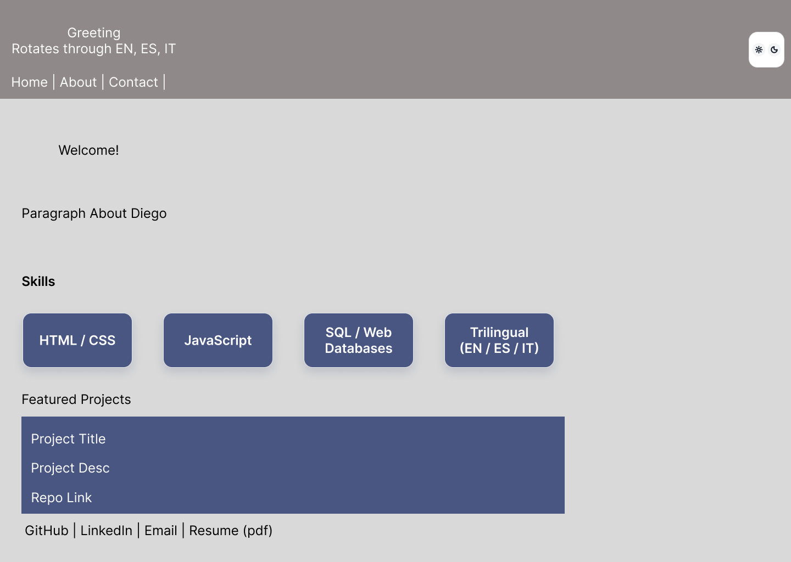
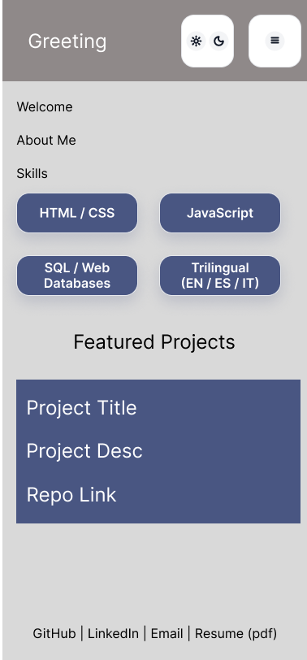
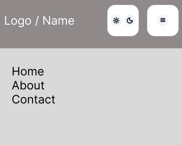
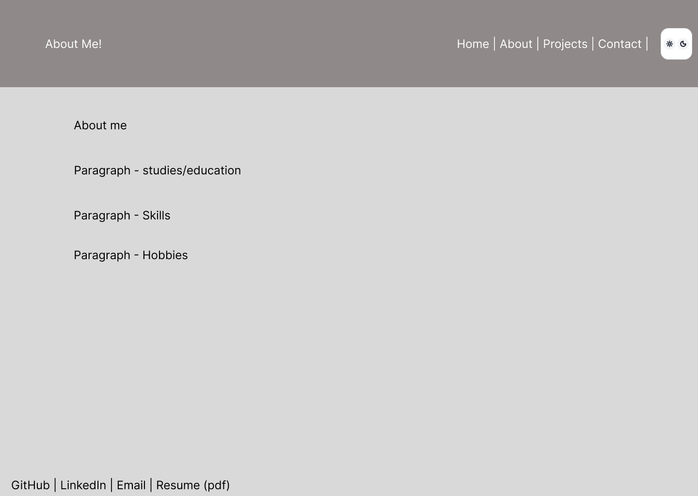
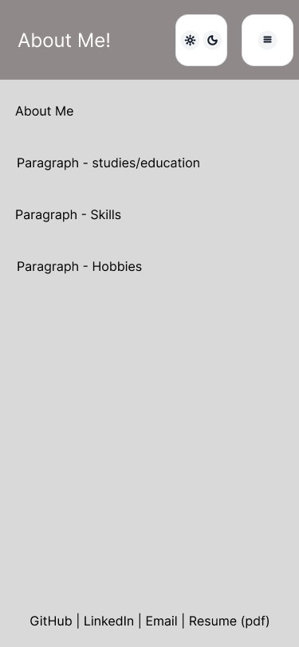
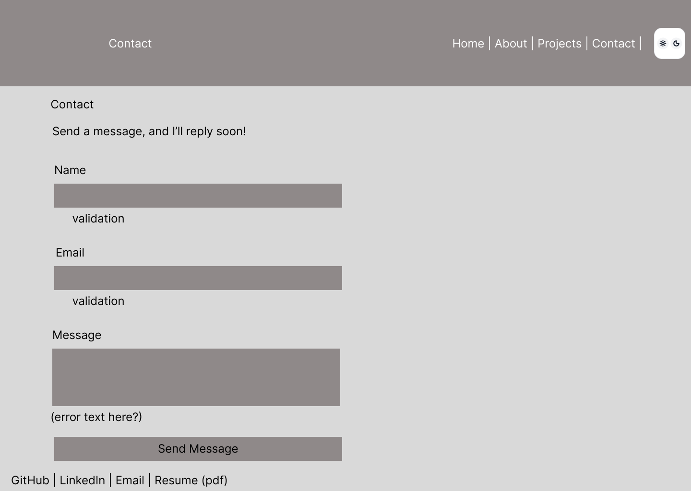
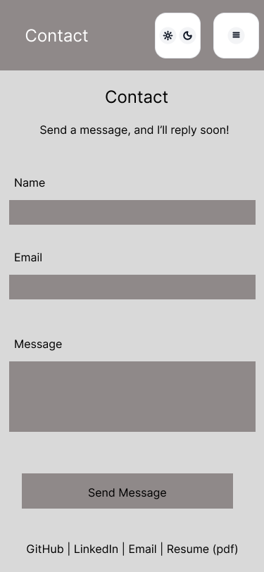

# Diego Morataya | Personal Portfolio Website

**Live site:** [https://meiisho.github.io/Portfolio/](https://meiisho.github.io/Portfolio/)  
**Repository:** [https://github.com/meiisho/Portfolio](https://github.com/meiisho/Portfolio)

This README serves as the Web Design Document for my portfolio project. It details the strategy, design choices, technical setup, and complete answers to all required worksheet questions.

---

## 1. Project Overview

This is a responsive personal portfolio website built completely from scratch using vanilla HTML5, custom CSS3, and JavaScript, hosted on GitHub Pages. Its purpose is to showcase my technical background, web development projects, and skills to potential employers for entry-level front-end development and IT support roles.

**Goals**
- Present a clear professional identity: my major, expected graduation, core stack, and career direction.
- Showcase real hand-coded work, prioritizing complete, production-ready projects over unfinished concepts.
- Deliver an ultra-fast, high-contrast, accessible user experience across mobile and desktop devices with dark/light theme switching.

---

## 2. Target Audience

- **Primary: Employers and Technical Recruiters** seeking entry-level front-end developers, web designers, or UI/UX support specialists. Content is arranged so key skills and featured projects are visible immediately upon landing.
- **Secondary: Peers and Instructors** looking to evaluate clean front-end code structure, CSS layout architecture, and vanilla JavaScript functionality.

---

## 3. Content Strategy

- **Voice:** Direct, honest, and professional. Code features and skills are described clearly without unnecessary fluff.
- **Order of Importance:** Header & dynamic greeting, core focus & skills, featured project showcase, educational background, and direct contact options.
- **Key Highlights:** Trilingual fluency (English, Spanish, Italian), front-end & database fundamentals (HTML5, CSS3, JavaScript, SQL), and visual UI styling with Figma.
- **Calls to Action:** Direct project repository links and an accessible PDF resume link (`Diego_Morataya_Resume.pdf`) that opens in a clean tab (`target="_blank"`).
- **Proof over Claims:** Every listed project features a summary of the technical architecture used, key features implemented, and direct source code links.

---

## 4. Information Organization

| Page | File | Purpose |
|---|---|---|
| Home | `index.html` | Multilingual greeting (*Hello! / Hola! / Ciao!*), core skills summary tags, and featured primary developer portfolio project |
| About | `about.html` | Detailed professional background, academic major info, core technical skills, and personal interests |
| Contact | `contact.html` | Serverless contact form integration alongside direct mailto email and professional profile links |

Every page shares a unified header structure (trilingual greeting heading, subtitle, navigation bar, and theme toggle control) and a consistent site footer (GitHub, LinkedIn, email, downloadable resume PDF link).

---

## 5. Visual Design

### Wireframes

<!-- Wireframe references for site layouts -->

**Home Page Layout - Desktop & Mobile**




**About Page Layout - Desktop & Mobile**



**Contact Page Layout - Desktop & Mobile**




### Color

The site utilizes a custom CSS Variable engine that supports dark mode by default with an instant light mode override toggle.

| Role | Dark Theme | Light Theme |
|---|---|---|
| Background | `#0f0f11` | `#fafafa` |
| Surface / Cards | `#18181c` | `#ffffff` |
| Primary Text | `#f0f0f2` | `#111827` |
| Secondary Text | `#9999a1` | `#4b5563` |
| Accent Color | `#8b5cf6` | `#6d28d9` |
| Borders | `#2e2e38` | `#e5e7eb` |

Purple accents were selected to provide personal visual flair while maintaining strong visual contrast against dark and bright backgrounds alike.

### Typography
- **Headings (`h1`, `h2`, `h3`):** System font stack (`-apple-system`, `BlinkMacSystemFont`, `"Segoe UI"`, `Roboto`, `sans-serif`) with custom uppercase letter-spacing for headings to maintain fast loading speeds and high cross-platform compatibility.
- **Body Text (`p`, `a`):** Clean system sans-serif font stack tuned for accessible reading across mobile screens and high-resolution displays.
- **Code & Skill Badges:** Monospace system fallbacks (`Consolas`, `Monaco`).

### Icons and Elements
To keep initial payload sizes small and eliminate image request overhead, icons are powered by lightweight system symbols (such as `☀` and `☾` for light/dark theme toggles).

---

## 6. Interaction and Functionality

All custom interactivity is self-contained in `script.js` and wrapped inside a `DOMContentLoaded` listener to ensure fast, bug-free execution across all pages.

| Feature | Technical Implementation | Feedback to Visitor |
|---|---|---|
| Theme Toggle | Reads/writes `data-theme` attribute on `<html>` root and persists setting in `localStorage` | Palette transitions smoothly and toggle icon flips between `☀` and `☾` |
| Multilingual Rotator | JavaScript `setInterval` loop cycling through English, Spanish, and Italian greetings | Heading text automatically updates every 2.2 seconds (*Hello! / Hola! / Ciao!*) |
| Contact Form | Integrates Formspree POST action endpoint for serverless message handling | Native form validation triggers for invalid emails or missing inputs |
| Responsive Layout | CSS Flexbox with wrapping media queries (`@media (max-width: 650px)`) | Layout reorganizes into a single column with full touch target padding on mobile |

---

## 7. Technical Overview

- **Stack:** Semantic HTML5, CSS3 (Custom Variables, Flexbox, Media Queries), Vanilla JavaScript (ES6+). Zero external frameworks or heavy dependencies.
- **Hosting:** GitHub Pages, deployed directly from the `main` branch.
- **Form Handling:** Formspree API.
- **Architecture:** Shared external stylesheet (`styles.css`) and modular JavaScript (`script.js`).

**File Structure**
```text
Portfolio/
├── index.html                   # Home page & featured project showcase
├── about.html                   # Professional background & education
├── contact.html                 # Contact form & profile links
├── styles.css                   # Global CSS stylesheet & theme variables
├── script.js                    # Theme toggle & greeting rotator logic
├── Diego_Morataya_Resume.pdf    # Downloadable resume PDF
└── README.md                    # Web design document & assignment specs
```

---

## 8. Timeline and Milestones

| Date | Milestone |
|---|---|
| Oct 2026 | Planned wireframes, defined content strategy, and established semantic HTML structure across all pages |
| Oct 2026 | Built external `styles.css` stylesheet with dark/light CSS color variables, flexbox grids, and mobile media query rules |
| Oct 2026 | Scripted `script.js` for persistent theme state in `localStorage` and dynamic trilingual greeting rotator |
| Oct 2026 | Connected Formspree backend, completed cross-device mobile testing, pushed fresh repository, and deployed on GitHub Pages |

---

## 9. External Resources

- [MDN Web Docs](https://developer.mozilla.org/) — Reference for HTML5 semantics, CSS variables, and JavaScript DOM manipulation
- [GitHub Pages Documentation](https://docs.github.com/en/pages) — Site hosting configuration
- [Formspree](https://formspree.io/) — Serverless contact form handling

---

## 10. Assignment Questions and Answers

### Part 1: Content

1. **What is your full name as you want it displayed professionally?**  
   Diego Morataya

2. **What is the purpose of your portfolio website?**  
   To showcase my technical skills, present my front-end web development projects, and provide a direct contact method for entry-level tech roles.

3. **Who is the target audience (employers, clients, peers, etc.)?**  
   Technical employers, hiring managers, recruiters, and academic peers.

4. **What skills do you want to highlight?**  
   Trilingual fluency (English, Spanish, Italian), Web Development & Database Fundamentals (HTML5, CSS3, JavaScript, SQL), UI/UX design tools (Figma), and rapid technical troubleshooting.

5. **What projects or work will you showcase?**  
   My Personal Portfolio Website, built completely from scratch using vanilla HTML5, CSS custom variables, and vanilla JavaScript.

6. **How will you describe yourself in a short professional bio?**  
   I am a Computer Programming and Information Systems student at Farmingdale State College (expected graduation Fall 2027). I specialize in front-end web development, clean CSS styling, web databases, and user interface design. I bring strong multilingual communication skills and practical technical troubleshooting experience.

7. **What pages will your site include (Home, About, Projects, Contact, etc.)?**  
   Home (`index.html`), About (`about.html`), and Contact (`contact.html`), with featured projects displayed directly on the Home page for immediate access.

8. **What is your career goal or desired role?**  
   A role as a Front-End Developer, Web Designer, or UI/UX Specialist.

9. **What technologies or tools do you have experience with?**  
   HTML5, CSS3, JavaScript, Java, SQL / MySQL, Figma, Cisco Packet Tracer, VS Code, Git/GitHub, and PC hardware troubleshooting.

10. **What achievements or experiences are worth highlighting?**  
    Coursework in Web Database Development and Data Structures, trilingual fluency in English, Spanish, and Italian, and hand-coding responsive web interfaces with modular CSS architectures and dark-theme aesthetics.

11. **What call-to-action should visitors take (contact you, view projects, download resume)?**  
    View Featured Projects on the Home page, with a secondary call-to-action to view my Resume PDF (`Diego_Morataya_Resume.pdf`).

12. **Will you include a resume? In what format?**  
    Yes, as a PDF linked in the footer using `target="_blank"` so it opens in a new tab without interrupting the browsing experience.

13. **What social or professional links will you include (GitHub, LinkedIn, etc.)?**  
    GitHub, LinkedIn, and personal email for better mail control.

---

### Part 2: Design

1. **What overall style will best represent you (minimalist, creative, professional, etc.)?**  
   Modern, minimalist, dark-themed tech aesthetic with clean content padding, crisp contrast, and purple accents.

2. **What color scheme will you use and why?**  
   A deep dark background (`#0f0f11`) with clean surface cards (`#18181c`) and vibrant purple accent highlights (`#8b5cf6`). It provides strong visual personality while maintaining high contrast and readability. A light mode switcher is also included (`#fafafa` background / `#6d28d9` purple accent).

3. **What fonts will you use for headings and body text?**  
   A clean system sans-serif stack (`-apple-system`, `BlinkMacSystemFont`, `Segoe UI`, `Roboto`) with custom uppercase letter-spacing for headings to maintain fast loading speeds and high cross-platform compatibility.

4. **How will your design reflect your personality or field?**  
   The clean dark-theme layout fits a technical development background, while purple accents and the trilingual rotator (*Hello! / Hola! / Ciao!*) add distinct personal touches.

5. **What layout will your homepage follow?**  
   Header with greeting, subtitle, navigation, and theme toggle → Hero welcome section → Core Focus skill tags → Featured Projects section → Site footer with social links and copyright.

6. **How will you organize project sections visually?**  
   Using card containers with distinct borders, subtle elevation shadows, left accent bar indicators on section headers, and high-contrast callout links.

7. **Will the site be mobile-friendly? How will you ensure responsiveness?**  
   Yes. Built using fluid Flexbox containers, media queries (`@media (max-width: 650px)`), dynamic typography adjustments, and touch-friendly navigation spacing.

8. **What visual hierarchy will guide visitors?**  
   Bold section headers with left accent borders, clear contrast between primary and secondary text colors, and subtle card background separation.

9. **How will consistency be maintained across pages?**  
   By linking a single shared external stylesheet (`styles.css`) across all HTML files and using uniform header/footer templates.

10. **How will accessibility be considered (contrast, font size, readability)?**  
    Through semantic HTML5 elements (`<header>`, `<main>`, `<nav>`, `<article>`, `<footer>`), high contrast text-to-background ratios meeting WCAG guidelines, scalable relative font sizes (`rem`), and visible link hover/focus states.

11. **Will you use icons, images, or illustrations? Why?**  
    Simple text and Unicode symbols are used for interactive controls (such as `☀` and `☾`) to ensure instantaneous page loads without asset rendering delays.

12. **What portfolio websites inspired your design?**  
    No single website served as inspiration; the design was developed independently through hands-on coding practice and a personal preference for minimal, functional layouts.

---

### Part 3: Interactivity

1. **What interactive elements will your site include (navigation menus, buttons, forms)?**  
   Navigation links, theme toggle button (`☀` / `☾`), project repository links, and a serverless contact form.

2. **Will your site include a contact form? How will it work?**  
   Yes, on `contact.html`. It collects visitor name, email, and message inputs and posts directly to Formspree, delivering messages straight to my inbox.

3. **What JavaScript features will you implement?**  
   A light/dark theme switcher leveraging localStorage for state persistence, paired with CSS transition properties to create a smooth color fade between modes.

4. **How will users receive feedback from interactions?**  
   Instant color theme transitions, visual hover/focus states on links and buttons, and active text changes on theme button toggles.

5. **How does interactivity improve the user experience?**  
   It provides immediate visual feedback, remembers user theme preferences across visits, and allows recruiters to navigate content effortlessly on both mobile and desktop.
